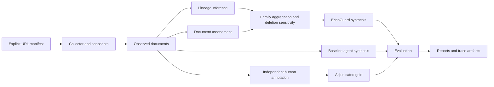

# Architecture

The benchmark stores one atomic claim per case, multiple candidate source documents, and a private gold-label block. Gold truth and evidence families are evaluation data. A model-input allowlist includes only the claim and observed source fields.

`lineage.js` groups source documents with union-find. Edges come from quoted upstream attributions, exact normalized passages, or high lexical overlap. Attribution can target an unavailable external upstream URL; multiple sources citing that URL can still cluster. A directed strongly connected component detects circular attribution. Contradictory timestamps are recorded without silently breaking the cycle. The algorithm is order-invariant for cluster membership and family IDs.

Singleton and clustered components retain `independence: unknown`. The engine does not equate publisher count with independent measurements. A URL on the same hostname is grouped only in the intentionally simple hostname baseline. Lexical derivation remains a possible relationship, not a proven parent direction. Exact duplicates are undirected.

`guard.js` gives each estimated family at most one supporting and one contradicting vote, using the maximum passage-relation confidence for each direction. Opposing evidence within a family can cancel. The sum is passed through a logistic function with fixed scale; this is explicitly an uncalibrated score. Deleting each family tests decision sensitivity. Search queries are emitted as a plan, without automatic execution.

`provider.js` makes stateless model requests. The baseline sees documents; the diversity baseline also receives a diversity instruction; EchoGuard sees documents plus lineage estimates and sensitivity. Prompt/output schemas are versioned. Cache identities include endpoint, model, complete request, prompt version and repetition. Refusals, malformed outputs and unsupported schemas fail visibly. Quoted evidence is validated even on cache hits.

`experiment.js` writes checkpoints after each completed case and the completion marker after report generation. Score metrics exclude unknown truth from accuracy/calibration. Source-family metrics omit unresolved gold labels. Bootstrap resampling uses events as units rather than treating duplicate conditions as independent samples. All transformation variants stay paired with their original event.

`server.js` binds loopback. It hides gold, serves fixed static files, rejects foreign Host/Origin headers, stores revisioned annotation history, and rejects concurrent stale updates. Annotation output is separate from the input dataset. Gold export explicitly selects an annotator/adjudicator.

`collector.js` performs bounded, public-only HTTP(S) requests, pins a resolved public IP, validates every redirect, and honors robots policy. It extracts text and links, saves raw snapshots and hashes, and leaves attribution judgments to review. It supports simple UTF-8 HTML/plain text; extraction quality is not equivalent to a browser or a full article parser.
